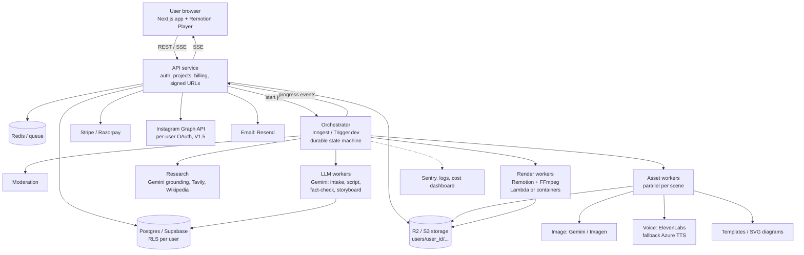
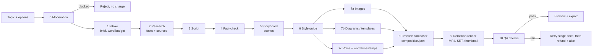
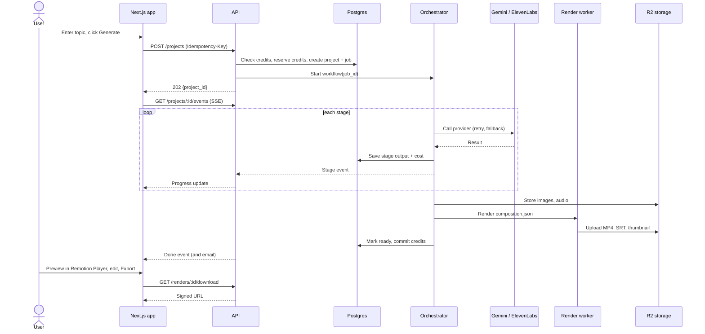
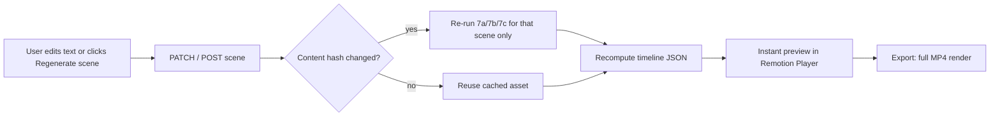
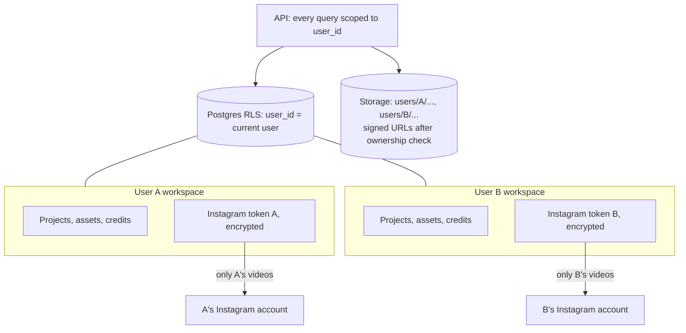
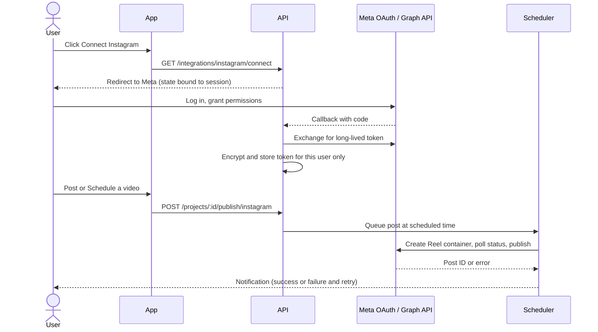
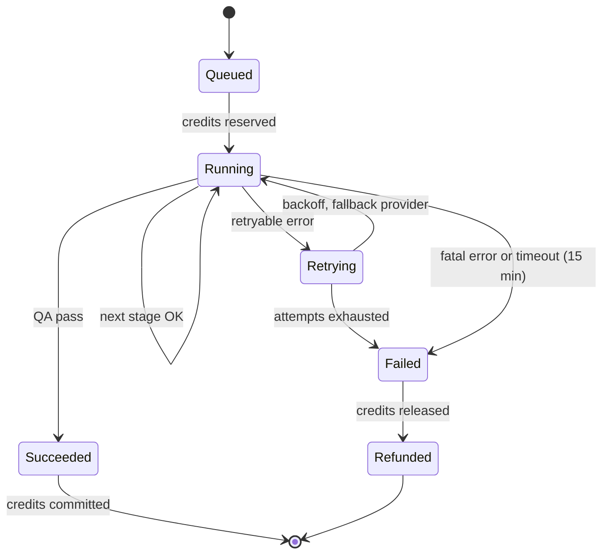

# VideoReel: Architecture Diagrams

Mermaid diagrams. They render in GitHub, VS Code (Markdown preview) and the Copilot app editor canvas.

## 1. High-level system architecture

## 2. Generation pipeline (how a video is made)

## 3. Request sequence (what happens when the user clicks Generate)

## 4. Edit and regenerate one scene

## 5. Multi-user isolation and per-user Instagram

## 6. Instagram connect and post (V1.5)

## 7. Job state machine and failure handling

## 8. How it works (plain-language walkthrough)
1. **Input:** the user types a topic and clicks Generate. The API checks credits, reserves them and starts a job.
2. **Brain:** the orchestrator runs the stages in order. Gemini researches, writes and fact-checks the script, then splits it into scenes.
3. **Hands:** for each scene, images, diagrams and the ElevenLabs voice are created in parallel. ElevenLabs returns word timestamps.
4. **Glue:** the timeline composer uses the audio timing to set each scene's length and the caption timing, and writes one `composition.json`.
5. **Render:** Remotion turns `composition.json` into an MP4, with FFmpeg handling audio. A QA step checks the result.
6. **Delivery:** the browser shows live progress, then a preview. The user edits (cheap, JSON-based) and exports. Credits are committed on success and refunded on failure.
7. **Privacy:** every step is scoped to the user, so nobody sees anyone else's data or Instagram account.
